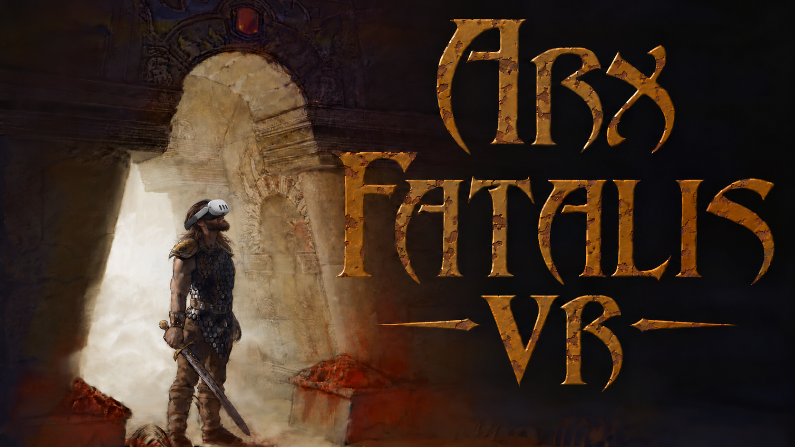

<p align="center">
  
</p>

<h1 align="center">Arx Fatalis VR</h1>

<p align="center"><em>Step into the underworld with your own hands.</em></p>
<!-- the tagline above is a proposal (#401) -->

<p align="center">
  <a href="https://github.com/Arziburst/arx-fatalis-vr/actions/workflows/build-windows.yml"></a>
  <a href="COPYING"></a>
  <a href="https://github.com/Arziburst/arx-fatalis-vr/milestone/1"></a>
  
</p>

**Arx Fatalis VR** is a virtual-reality port of [Arx Fatalis](https://store.steampowered.com/app/1700/Arx_Fatalis/),
the 2002 first-person dungeon RPG by Arkane Studios, built on the open-source
[Arx Libertatis](https://arx-libertatis.org/) engine. It uses **OpenXR** with **SteamVR** as the runtime and is
built for the **Valve Index**: you look around with your head, see your own body and arms, fight by swinging a
weapon, and cast spells by drawing runes in the air. The goal is a **free standalone Steam app** that needs the
original Arx Fatalis (Steam app 1700) on your account — the game's data is never included.

> **Not released yet.** There is no download for players. The project is public so that you can follow it,
> test it and contribute.

## Contents

- [Status](#status)
- [Features](#features)
- [Requirements](#requirements)
- [How to play and test](#how-to-play-and-test)
- [Build and run (developers)](#build-and-run-developers)
- [Documentation map](#documentation-map)
- [Report a bug and contribute](#report-a-bug-and-contribute)
- [Credits and legal](#credits-and-legal)

## Status

**In development — working towards the MVP** (milestone [M1 MVP](https://github.com/Arziburst/arx-fatalis-vr/milestone/1);
the badge above shows closed tasks of all its tasks). The MVP is a short, rough but convincing demo of the core
VR experience, played in a Valve Index from a new game at the start of Arx Fatalis (the goblin prison and the
first areas after it):

1. walk around with the thumbstick (forward = where you look), turn with snap or smooth turn, crouch for real, jump;
2. look down and see your own body, with the arms following the controllers;
3. pick up items, open doors and chests, pull levers — each hand works as the mouse with its own reticle;
4. open the inventory and the book on a floating panel; health and mana on the left wrist;
5. fight a goblin by physically swinging the weapon in your hand;
6. cast a spell by drawing its runes in the air;
7. open the menu, save and load — all without keyboard and mouse.

The plan, checkpoints and known limits of the MVP: [docs/vr/MVP.md](docs/vr/MVP.md). After it come
**M2 Full Game & Polish** (shield, bow, diegetic UI, cutscenes, comfort options, a full playthrough) and
**M3 Steam Release** (rights, licensing, store page). Live board:
[Arx Fatalis VR project board](https://github.com/users/Arziburst/projects/3).

## Features

What works **today** (on `main`; judged in the headset by the project owner):

- **VR rendering** — OpenXR stereo at the headset's native rate, MSAA, correct world scale, desktop window mirrors one eye.
- **Head-tracked camera** — the camera is where your head is: leaning, real steps with a wall fade, physical
  crouch, recenter, seated mode ([D-018](docs/vr/DECISIONS.md)).
- **Full body with IK arms** — the engine's player model, head hidden, arms follow the controllers
  ([D-009](docs/vr/DECISIONS.md), [D-032](docs/vr/DECISIONS.md)); the fingers follow your real fingers through
  hand tracking, with a controls-based fallback ([D-041](docs/vr/DECISIONS.md)).
- **Locomotion** — stick forward = where you look ([D-008](docs/vr/DECISIONS.md)), snap and smooth turn, jump, crouch toggle.
- **Hand reticles** — both hands work as the mouse, each with its own reticle and no rays from the hands:
  drag items, set them down, put them into the inventory ([D-016](docs/vr/DECISIONS.md), [D-036](docs/vr/DECISIONS.md)).
- **Floating panel and wrist bars** — menus, inventory, book and map on one panel, a pointer only while a menu is
  open; health and mana as two bars on the left wrist.
- **Physical melee** — the weapon is held by the IK hand, the swing is the strike, the trigger charges it
  ([D-033](docs/vr/DECISIONS.md), [D-038](docs/vr/DECISIONS.md)).
- **Runes in the air** — a glowing rune trail follows the drawing hand ([D-040](docs/vr/DECISIONS.md)).
- **VR settings** — remapping of the controls (button, chord, long press) per controller type, turning and height
  rows ([D-039](docs/vr/DECISIONS.md)).
- **Comfort defaults** — head bob, screen shake and FOV zoom disabled.
- **Test playground** — a generated room with every weapon, potions and a max-level hero for combat and magic tests.
- **Launch** — finds the Arx Fatalis data in your Steam libraries on its own; starts in VR when a headset is available.

**Planned** (not working yet — see the [board](https://github.com/users/Arziburst/projects/3)):

- **Control scheme v2** ([D-042](docs/vr/DECISIONS.md)): two equal hands, a casting stance and a **radial menu**
  per hand, spells drawn with both hands at once, dual wielding and two-handed weapons.
- Recognition of the drawn runes as spells, and haptic feedback.
- Doors, levers, chests and searching bodies with the hand reticle.
- A proper start menu and character creation in the headset; first-run flow.
- Our own arm and hand meshes, a torch held in the hand, a melee swing delay and a visible strike charge.
- Launch from SteamVR with no setup, and a Steam release.
- Later (M2): shield and blocking, bow, diegetic UI, cutscene handling, more comfort options, other headsets (Quest 3 via SteamVR).

Known problems we live with in the MVP (flat 2D menus, cutscenes, some screen-space effects): see
[MVP.md](docs/vr/MVP.md#accepted-for-the-mvp-known-problems-we-live-with).

## Requirements

| What | Notes |
|---|---|
| **Arx Fatalis** (original game) | [Steam app 1700](https://store.steampowered.com/app/1700/Arx_Fatalis/) on your account. This project ships no game data |
| **PC VR headset with SteamVR** | the **Valve Index** first; other headsets and controllers as they get tested |
| **Windows 10/11, 64-bit** | the only platform of the VR port |
| A graphics card that drives your headset | the game itself is light, but VR renders the scene twice |

## How to play and test

There is **no public release yet**. Until then:

- **Testers** get a tester zip from the project owner — it runs without any toolchain; see
  [docs/vr/TESTING.md](docs/vr/TESTING.md#the-tester-package-88).
- **Developers** build from source (below). To make SteamVR show "Arx Fatalis VR" with its tile and to launch it from
  the SteamVR library, see [docs/vr/STEAMVR.md](docs/vr/STEAMVR.md).
- Everything can be tried without a headset too: flat mode (`--no-vr`) and a simulated headset (`--vr-sim`), see
  [docs/vr/TESTING.md](docs/vr/TESTING.md).

## Build and run (developers)

You need Visual Studio 2022 (or Build Tools) with the C++ workload, CMake, Git and PowerShell 7; the dependencies
come from vcpkg automatically.

```powershell
git clone https://github.com/Arziburst/arx-fatalis-vr.git
cd arx-fatalis-vr
.\scripts\build-windows.ps1       # Release build + host unit tests
.\scripts\run-windows.ps1         # runs it; finds the Arx Fatalis data in the Steam libraries
```

SteamVR is started by you, never by the scripts (without it the game starts flat). The full guide — options, test
saves, launch rules, the playground — is in [docs/vr/DEVELOPMENT.md](docs/vr/DEVELOPMENT.md); how to check a change
without a headset is in [docs/vr/TESTING.md](docs/vr/TESTING.md). The original Arx Libertatis build instructions
(Linux, macOS, options) are kept in [docs/ARX-LIBERTATIS.md](docs/ARX-LIBERTATIS.md) — the VR port itself targets Windows only.

## Documentation map

| Document | What is in it |
|---|---|
| [docs/vr/MVP.md](docs/vr/MVP.md) | the MVP goal, demo scenario, scope, checkpoints, task queue |
| [docs/vr/DECISIONS.md](docs/vr/DECISIONS.md) | every significant decision and why |
| [docs/vr/DEVELOPMENT.md](docs/vr/DEVELOPMENT.md) | how to build and run |
| [docs/vr/TESTING.md](docs/vr/TESTING.md) | testing without a headset: smoke test, simulated headset, test channel, playground |
| [docs/vr/STEAMVR.md](docs/vr/STEAMVR.md) | SteamVR registration and the Steam shortcut |
| [docs/vr/WORKFLOW.md](docs/vr/WORKFLOW.md) | how work is organised: tasks, board, PRs, naming |
| [docs/vr/TRAPS.md](docs/vr/TRAPS.md) | pitfalls that already cost us time |
| [docs/vr/RESEARCH-reference-mods.md](docs/vr/RESEARCH-reference-mods.md) | the research catalog: what other VR mods do and what we take |
| [docs/vr/RESEARCH-controllers.md](docs/vr/RESEARCH-controllers.md), [VR-CHECKLIST.md](docs/vr/VR-CHECKLIST.md), [RESEARCH-playable-v1.md](docs/vr/RESEARCH-playable-v1.md) | controllers, what players expect from a VR game, the estimate |
| [docs/ARX-LIBERTATIS.md](docs/ARX-LIBERTATIS.md) | the original Arx Libertatis README |

## Report a bug and contribute

- **Bugs and ideas:** open an [issue](https://github.com/Arziburst/arx-fatalis-vr/issues/new/choose) (templates for a bug
  and a task). Say what you did, what you expected, and attach `arx.log`.
- **Pull requests** from forks are welcome. CI does not run on forks until a maintainer approves it, and a person
  reviews every PR before it is merged. Naming of branches, commits and PRs: [WORKFLOW.md](docs/vr/WORKFLOW.md#commit-and-pull-request-naming).
- Work is tracked on the [project board](https://github.com/users/Arziburst/projects/3), tasks grouped in nine epics
  (build, rendering, camera, controls, interaction and combat, magic, UI, comfort, Steam release).
- The engine-level contribution rules of Arx Libertatis (code style, licensing of contributions) are in
  [CONTRIBUTING.md](CONTRIBUTING.md). All project documents, issues and commits are in English.

## Credits and legal

- **[Arx Libertatis](https://arx-libertatis.org/)** — the cross-platform open-source engine this port is built on,
  by the Arx Libertatis Team and contributors ([AUTHORS](AUTHORS)). It is based on the publicly released
  [Arx Fatalis source code](https://web.archive.org/web/20180105233341/https://www.arkane-studios.com/uk/arx_downloads.php).
  Its contacts: [website](https://arx-libertatis.org/), [bug tracker](https://bugs.arx-libertatis.org/),
  IRC `#arx` on libera.chat, [wiki](https://wiki.arx-libertatis.org/), [/r/ArxFatalis](https://old.reddit.com/r/ArxFatalis/).
- **Arx Fatalis** — the original game, © Arkane Studios. You need your own copy.
- **Licence:** GPLv3 or newer with some additional terms — see [COPYING](COPYING) and [LICENSE](LICENSE).
- **Third-party components**, under the licences shipped in this repository:
  [DejaVu fonts](LICENSE.DejaVu), [fast_float](LICENSE.fast_float) (MIT), [stb](LICENSE.stb) (MIT / public domain),
  the [xr_hello](LICENSE.xr_hello) OpenXR probe and the [`.xrs` sequence runner](LICENSE.xrsim), both adapted from
  Dishonored VR (MIT). The test playground is generated with
  [arx-level-generator](https://github.com/arx-tools/arx-level-generator) (MIT) and is not committed.
- **Not affiliated:** this is an unofficial fan project. It is **not affiliated with or endorsed by Arkane Studios or
  Bethesda** (or ZeniMax), and it ships **no game data**: the original Arx Fatalis files are read from your own
  installation.
